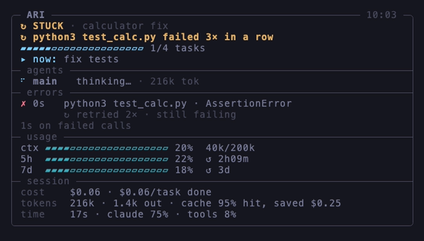
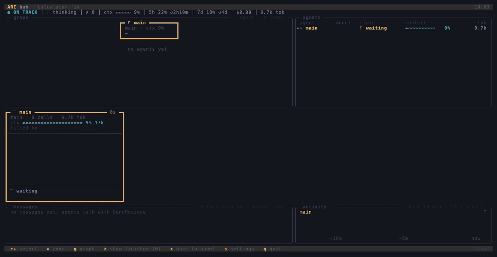
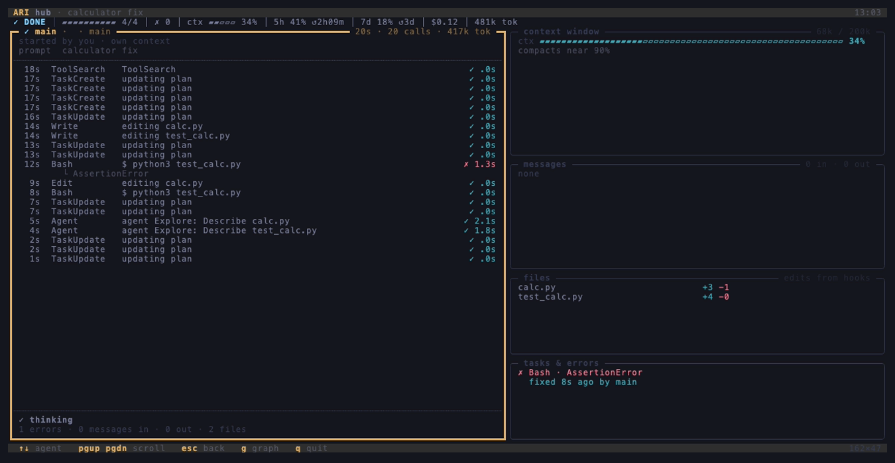
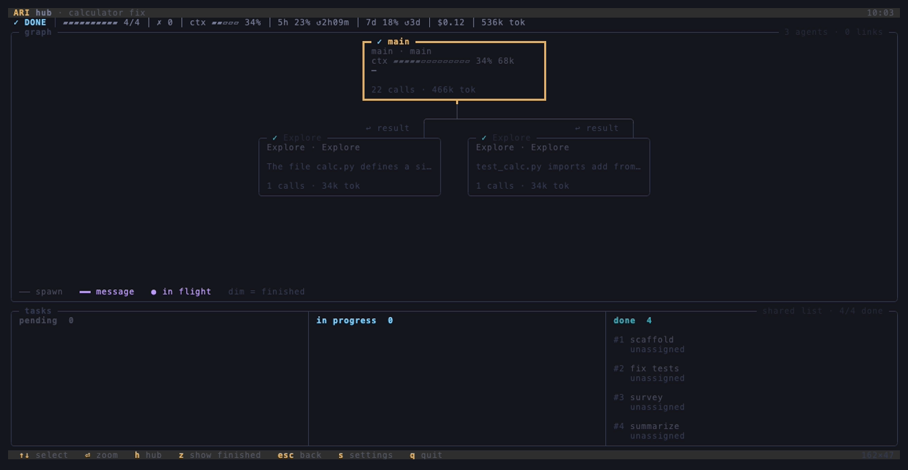

<div align="center">

# ARI

### Stop asking Claude how it's going.

**All Relevant Information**: a zero-token status panel for Claude Code.

[](https://github.com/Izuulo/ari/actions/workflows/ci.yml)
[](https://github.com/Izuulo/ari/releases/latest)
[](LICENSE)


[Install](#install) · [What you get](#what-you-get) · [The hub](#every-agent-at-once-the-hub) · [Commands](#commands) · [Config](#config) · [FAQ](#faq)


</div>

ARI watches your session through hooks and the statusline and answers *how far along are we, and is anything wrong?* at a glance, so you never have to interrupt a long run to ask. Nothing is ever sent to the model, and nothing leaves your machine.

## Install

```sh
curl --proto '=https' --tlsv1.2 -LsSf https://github.com/Izuulo/ari/releases/latest/download/ari-cli-installer.sh | sh
claude plugin install ari --marketplace Izuulo/ari
ari setup
```

1. Installs the `ari` binary to `~/.local/bin` (macOS and Linux). With Homebrew: `brew install Izuulo/tap/ari`. With Rust: `cargo install --git https://github.com/Izuulo/ari ari-cli`.
2. Adds the plugin whose hooks feed ARI. In-app: `/plugin marketplace add Izuulo/ari`, then `/plugin install ari@ari`.
3. Adds ARI's row to your statusline. It shows the change, asks first, and keeps your current statusline running alongside.

Start a new Claude Code session (or `/reload-plugins`) and the row appears. Something missing? `ari doctor` says what and how to fix it. Just want to look? `ari demo` replays a real session with no Claude needed.

## What you get

**A row in your statusline**, always visible:

```
● ON TRACK │ ▰▰▰▰▰▰▱▱▱▱ 4/7 │ ⠼ 2 agents │ ✗ 0 │ ✓ 70 tests │ ctx ▰▰▰▰▱ 71% │ 5h 62% ↺1h40m │ 7d 34% ↺4d │ $2.69 │ 6.2M tok
```

**A full panel** in a second pane with `ari watch` (`tmux split-window ari watch` works fine). It follows the latest session in the current directory:

<p align="center"></p>

Keys (listed under the live panel): `q` quit, `e` fixed errors too, `a` all agents, `r` recap since your last prompt (`esc` closes it), `tab` next session, `x` the hub (below). `ari watch --all` lists every live session: `↑`/`↓` or `k`/`j` select, `enter` opens that session's panel, `esc` goes back to the list from an opened session and quits from the list. A stale agent (no activity for a while, maybe stuck) shows `?`; a session ARI has no hook events for shows `– not tracked`. Under the verdict a badges row shows model, effort, fast mode, permission mode, worktree, pull request and lines changed. `--ascii` for terminals without Unicode.

### Every agent at once: the hub

Press `x` in `ari watch` (or run `ari hub`) and the panel takes the whole terminal. It shows a graph of who spawned whom and who is messaging whom, a table of every agent with its own context window, and a watch window per running agent with its last tool calls, what it's doing now and the last message it got. Below those: the messages between agents and an activity lane per agent. `ari hub --all` (or `x` in `ari watch --all`) puts every live session's agents in one hub, each session a node under you. Here it is replaying `ari demo`:

<p align="center"></p>

<table>
<tr>
<td width="50%"></td>
<td width="50%"></td>
</tr>
<tr>
<td align="center"><sub><code>⏎</code> zoom: one agent's timeline, context, files and errors</sub></td>
<td align="center"><sub><code>g</code> graph: who spawned whom, with the task board</sub></td>
</tr>
</table>

`↑`/`↓` select an agent, `⏎` zooms into it (its timeline, what filled its context, files, tasks and errors), `g` opens the graph full size with the task list under it, `z` shows finished agents' windows, `esc` goes back one level and `x` returns to the panel. An agent waiting on a permission prompt shows the exact call and how long it has waited. ARI never answers it for you. The hub needs a 120×30 window (160×45 for everything); smaller, the panel says so and keeps going. "What filled it" is an estimate: each tool result is credited with the jump in input tokens on the next call.

### What a session got done: `ari recap`

```
recap     ~/proj · auth refactor · since start
verdict   ✓ DONE
done      4 tasks
            ✓ scaffold
            ✓ build
errors    1 hit · 1 fixed · 0 open
tests     58 passed → 71 passed
files     2 edited
            calc.py ×2
            test_calc.py
commits   1
            e885f9c feat: retry the token refresh
time      21m · claude 64% · tools 22% · idle 14%
cost      $2.69 · +156 −23 lines
models    opus-5-5 (main), haiku-5-5 (2 agents)
```

`--since prompt` covers only what happened since your last message; `--since 30m` the last half hour. `--md` prints Markdown bullets to paste into a PR. Built from ARI's own records, so it costs no tokens.

### The verdict

| Verdict | Means |
|---|---|
| `◉ NEEDS YOU` | Waiting on a permission prompt or your input |
| `✗ BLOCKED` | The turn ended on an API error, or right after a failure it never fixed |
| `↻ STUCK` | Going in circles: the same command failing again and again, or the same call repeated with nothing changing between |
| `↻ RETRYING` | Something just failed and Claude is still working on it |
| `● ON TRACK` | Working, nothing failing |
| `✓ DONE` | Turn finished and every task is complete |
| `◌ IDLE` | Turn finished; tasks incomplete or none |

## Other agents: Codex and DeepSeek Harness

ARI also follows Codex and DeepSeek Harness (`dsh`) sessions. They appear in `ari watch`, `ari watch --all`, the hub and `ari recap`. `ari setup` wires every app it finds (Claude Code, Codex, dsh), `ari uninstall` removes exactly what it added, and `ari doctor` shows one line per app.

| | Codex | DeepSeek Harness |
|---|---|---|
| Activity, tool calls, tests, subagents | yes | yes |
| Errors | test failures only | yes |
| Context fill, tokens, 5h/7d limits | yes, from Codex's rollout log | no (dsh doesn't expose its session log to hooks) |
| Cost | no | no |
| ARI row in the app's footer | no: run `ari watch` in a pane | no: run `ari watch` in a pane |

- **Codex:** after `ari setup`, run `/hooks` inside Codex once and approve ARI's hooks. Known limit: Codex doesn't give hooks a command's exit code, so a failing non-test command isn't shown as an error; a failing test run is.
- **dsh:** setup mounts dsh's Claude Code hook bridge (`@deepseek-ai/dsh-hooks-claude-code`) in `$DSH_HOME/cordis.patch.yml` (default `~/.dsh`), pointing at ARI's own hooks file. If you already use the bridge with your own hooks file, setup adds ARI's entries to that file instead. dsh support is tested from sample data shaped after dsh's documented payloads, not a recorded session.
- **Multi-session screens** label non-Claude sessions with their app, show account limits per app, and count dollar figures for Claude Code sessions only.

## Why ARI

| | |
|---|---|
| **A verdict, not just numbers** | One word tells you whether to look up from what you're doing |
| **Stuck detection** | Notices loops and repeated failures and says which command |
| **Errors tracked to resolution** | A failure is marked fixed, with who fixed it, when the same command later succeeds |
| **Per-agent view** | What each subagent is doing right now, its tool calls and token spend |
| **The hub** | Who spawned whom, who messages whom, and each agent's own context window, full screen |
| **Permission waits** | Which agent is waiting on you, for what call and how long; ARI never answers for you |
| **Cache savings** | Hit rate, roughly what caching saved, and an alert when the cache suddenly stops hitting |
| **Rate-limit foresight** | Warns when you'll hit the 5-hour limit before it resets |
| **Plays nice** | Chains your existing statusline instead of replacing it; `ari uninstall` restores it byte for byte |
| **Zero tokens** | Nothing is ever injected into Claude's context |

Progress comes only from Claude Code's own task list. When there isn't one, a Markdown plan the session wrote with `- [ ]` checkboxes stands in (its checked boxes are the progress); otherwise the statusline leaves progress out and the panel says `no plan yet`, rather than guess. On newer models the task tools are off unless you start Claude Code with `CLAUDE_CODE_ENABLE_TODO_TOOLS=1`.

## Commands

| Command | What it does |
|---|---|
| `ari setup [--yes] [--dry-run]` | Add ARI's row to your statusline, chaining the one you have |
| `ari uninstall [--yes] [--purge]` | Restore your original statusline byte for byte |
| `ari watch [--all] [--session <id>] [--once] [--ascii] [--hub]` | Full panel for this directory's session, or every live session |
| `ari hub [--session <id> \| --all] [--ascii]` | The hub: every agent, its messages and context |
| `ari recap [--session <id>] [--since start\|prompt\|30m] [--md]` | What a session got done |
| `ari demo [--speed <x>] [--ascii] [--once]` | Replay a bundled real session, no Claude needed |
| `ari doctor` | Check binary, plugin, statusline and hooks, with a fix for each problem |
| `ari replay <dir>` | Print a recorded session as a timeline |

`ari hook` and `ari statusline` are the entry points Claude Code calls; you never run them yourself. In Claude Code, `/ari:setup` and `/ari:doctor` do the same as their CLI twins.

## Config

Press `s` in `ari watch` (panel, hub or `--all` list) for the settings screen: theme, colours, what the statusline and the panel show, alerts. Every change saves to `~/.config/ari/config.toml` and shows at once, with a live preview of your statusline row and panel beside the list when the window is 110 wide. Edits you make to the file by hand apply live too, and `ari doctor` points out anything it can't read.

Every key is optional:

```toml
position = "top"            # ARI's row above or below your chained statusline
theme = "default"           # default · soft · vivid · colorblind · mono · claude · codex · deepseek · auto
hide = ["cost"]             # statusline segments to drop: conflicts now tasks agents errors tests ctx 5h 7d cost tokens
hide_panel = ["turns"]      # panel sections to drop: tasks (the checklist bar) agents errors usage session turns
face = false                # the little (•_•) in the panel header
bell = false                # ring the terminal bell when Claude needs you (ari watch)
ascii = false               # ASCII-only glyphs everywhere
max_width = 0               # compact row width; 0 = terminal width
retention_days = 7          # session logs older than this are deleted (at least 1)

[chain]
commands = []               # your previous statusline commands (ari setup fills this)
timeout_ms = 300            # a chained command slower than this is skipped

[thresholds]
ctx_warn = 60               # context % turns yellow
ctx_crit = 80               # and red
stuck_repeats = 3           # repeats before STUCK
compact_pct = 90            # context % where auto-compaction happens, for the forecast

[prices.claude-opus-5-5]    # optional, $ per million tokens, for the cache-savings estimate
input = 0.0
cache_read = 0.0

[colors]                    # override one colour of the theme: a name, "#rrggbb" or 0–255
good = "#5fd787"            # roles: good warn bad accent highlight info muted bar
```

| Theme | Looks like |
|---|---|
| `default` | the terminal's own green, yellow, red, cyan |
| `soft` | muted 256-colour pastels |
| `vivid` | the bright variants, for dark low-contrast terminals |
| `colorblind` | blue for good, orange for bad, never red against green |
| `mono` | no colour; dim and bold only |
| `claude` | Claude Code's orange and grey |
| `codex` | Codex's colours |
| `deepseek` | DeepSeek's colours |
| `auto` | follows the app of the watched session; multi-session screens use `default` |

Without `[prices]`, savings are estimated from the session's own cost. `NO_COLOR` is respected; glyphs always carry the meaning, so nothing relies on color alone.

## FAQ

**Does it cost tokens?** No. Hooks only append to a local log and print nothing; the statusline is never sent to the model.

**Does it slow Claude down?** Hooks take about 3 ms (p95) and never block; the statusline renders in about 3–6 ms.

**Will it break my statusline?** No. Your command runs with the same input and its output is printed untouched. If it fails or takes longer than 300 ms, only it is skipped. `ari uninstall` puts your settings back exactly.

**Where does my data go?** Nowhere. Everything stays in `~/.local/state/ari/` and is pruned after 7 days. No network, no telemetry.

**Windows?** Not yet; planned for 1.1.

## Contributing

Issues and PRs welcome; see [CONTRIBUTING.md](CONTRIBUTING.md). Design notes live in [docs/](docs/): the [PRD](docs/PRD.md) and [DECISIONS.md](docs/DECISIONS.md) (where ARI deviates from the PRD and why).

## License

[MIT](LICENSE)
